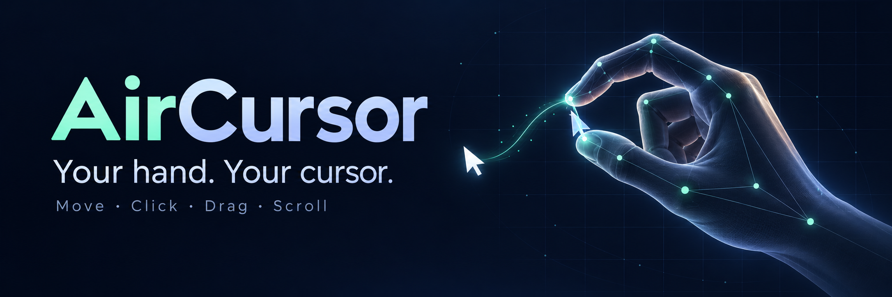
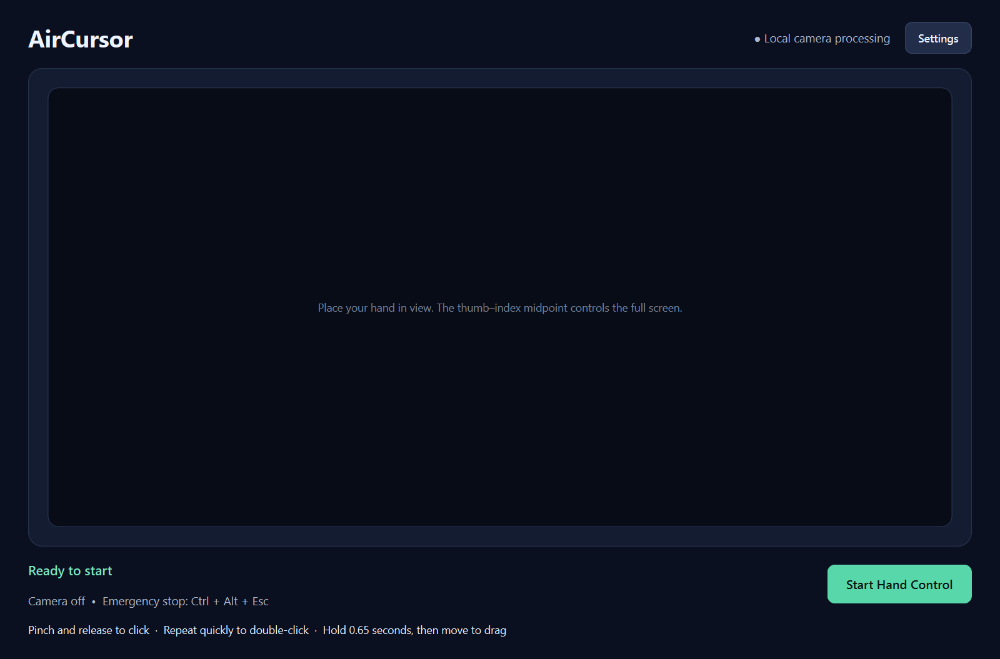
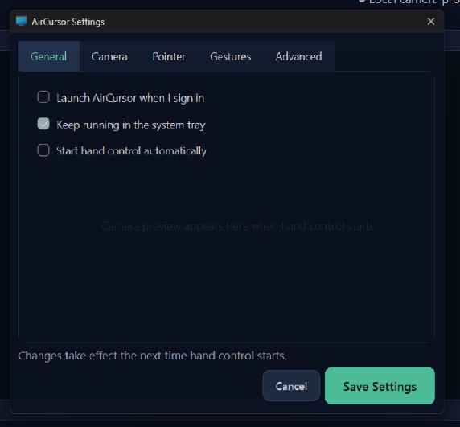
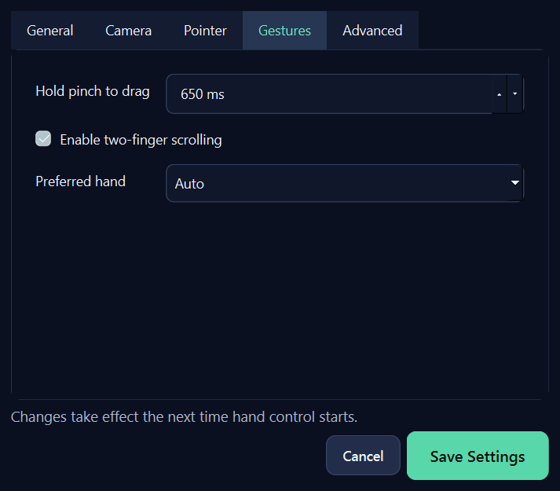

# AirCursor

AirCursor turns a webcam and one hand into a touchless mouse for Windows. It uses MediaPipe landmarks locally to move the pointer, click, drag, and scroll without recording or uploading video.

## This computer's Breadboard integration

Choose **Gestures**, next to **Voice** on Breadboard's home screen. The `/gestures`
page opens this checkout's configured controller and shows the live preview,
current gesture, external display, and custom gesture guide inside Breadboard.
Every new controller session starts with its pointer paused: hold a fist (three seconds by default), then
open your hand to enable pointing, clicking and CAD navigation. **Pause** releases held inputs; **Stop camera**
closes the camera. Navigating away leaves gesture control available for other
tabs and CAD apps. `Ctrl+Alt+Esc` stops it from anywhere.

The screen's **Settings** tab adjusts cursor sensitivity, smoothing, preferred
hand, pinch detection, left/right pinch click, drag delay, gesture confirmation
and fist timing, scroll speed, and CAD rotation/zoom. The V sign, bent hand and
straight hand can each hold Ctrl+Shift, scroll either way, or do nothing.
Each of these three gestures also has a **Use while paused** switch in the guide
that saves immediately, or in Settings alongside its action. An enabled gesture
works whenever the camera is on, without the fist countdown. For example, enabling
the V switch lets you hold Ctrl+Shift for voice while pointing and pinching remain
inactive. Releasing the sign releases the keys. Other gestures still require
activation unless their own switch is enabled. These switches default to off.
**Apply changes** atomically saves the preferences in `settings.json`, pauses
control, releases held inputs, and applies a fresh gesture state without reopening
the camera. The guide updates to match. **Reset defaults** stages the original
settings; press Apply to save them. Display/camera identity is preserved.

Sensitivity scales hand movement distance. Reacquiring a hand anchors at the
current external-monitor pointer, so the hand can be repositioned without a jump.
The green control frame now covers 88% of the camera width and height (6% margins).
The embedded preview keeps the full frame visible, with gesture status below it.

The desktop shell launches `start_external.pyw --embedded` using the installed
`.venv`, or attaches to an existing updated launcher without opening a second
camera. The ordinary desktop shortcut still supports the separate preview.
Camera frames remain in RAM and only travel over an authenticated loopback
connection to the gesture page. Preview encoding stops when the page is hidden.
The bridge descriptor in `.install-tmp/breadboard-controller.json` is temporary;
its secret is never exposed to page JavaScript. Only Breadboard's own top-level
gesture page can call the native bridge. This integration uses the existing
Windows installation; it does not bundle AirCursor into the Breadboard installer.

## Why this repository exists

This repository contains the reusable, auditable core of the AirCursor desktop project: landmark models, hand selection, coordinate mapping, adaptive smoothing, gesture state machines, Windows input, safety controls, and a runnable webcam demo. The 673 MB packaged application and its copied third-party runtime are intentionally excluded.

## Features

- Local-only webcam processing
- Stable left-, right-, or automatic-hand selection
- Pointer movement from the thumb/index midpoint
- Pinch and release to click
- Hold a pinch for 650 ms, then move to drag
- Two-finger vertical movement to scroll
- One Euro adaptive filtering for smooth but responsive motion
- Reduced camera control area mapped across the full display
- Automatic mouse-button release after tracking loss or failure
- `Ctrl+Alt+Esc` emergency stop and `Q` to quit the preview
- Framework-neutral core components with automated tests

## Quick start

### Clicks that behave predictably

A quick pinch-and-release emits a complete click immediately on release. It does not hold the mouse button down or wait for a possible second tap. Two quick taps use Windows' double-click interval and the same target when the wrist stays still; moving the wrist deliberately selects a new target. A drag starts only after a continuous 650 ms hold, and opening the pinch or losing tracking releases the mouse button. Pointer movement resumes after a click without a half-second freeze.

The updated portable Qt interface opens maximized on first use, remembers its window geometry, and provides a larger camera preview and visible gesture instructions. Preview size does not limit the control area: the hand midpoint maps to the full primary display.

The original portable app can be updated with [the reproducible Python 3.12 update tool](packaging/README.md). The GitHub source package also provides the lightweight OpenCV demo below. The original packaged Qt interface is preserved through compatibility adapters; its complete original source was not present in the supplied folder.

AirCursor supports Windows 10/11 with Python 3.11 or 3.12 and a webcam.

```powershell
git clone https://github.com/FarzamFattahi/aircursor.git
cd aircursor
python -m venv .venv
.venv\Scripts\Activate.ps1
python -m pip install -e .
aircursor
```

Keep your hand inside the green rectangle. Move using the midpoint between your index fingertip and thumb tip. Pinch and release to click, hold the pinch to drag, or extend only the index and middle fingers to scroll.

## Controls

| Action | Gesture or key |
|---|---|
| Move pointer | Move thumb/index midpoint |
| Click | Pinch, then release |
| Drag | Hold pinch for 650 ms |
| Scroll | Extend index and middle fingers; move vertically |
| Stop safely | `Ctrl+Alt+Esc` |
| Close preview | `Q` |

## Application views

| Main window | General settings |
|---|---|
|  |  |



The main-window screenshot shows the updated packaged Windows interface; the gesture settings also reflect the updated drag timing; the unchanged general settings view is from the original application. The repository focuses on the reusable computer-vision and interaction engine and includes a lightweight OpenCV demo rather than the proprietary build bundle.

## Architecture

```text
Webcam frame
    |
    v
MediaPipeHandDetector -> HandSelector -> GestureManager
                                           |
                     +---------------------+--------------------+
                     |                     |                    |
               PinchDetector        DragController       ScrollDetector
                     |
                     v
CoordinateMapper -> OneEuroFilter -> PointerGain -> TapStabilizer
                     |
                     v
              WindowsInputController
```

The vision layer produces small framework-neutral dataclasses. Gesture logic and pointer transforms have no OpenCV or MediaPipe dependency, which makes them reusable and easy to test. Platform input is isolated behind an abstract interface.

## Use components independently

```python
from aircursor.pointer import CoordinateMapper, OneEuroFilter

mapper = CoordinateMapper(screen_width=1920, screen_height=1080)
smoother = OneEuroFilter()

screen_point = mapper.map(0.42, 0.36)
stable_point = smoother.filter(screen_point, timestamp=1.25)
```

```python
from aircursor.gestures import DragAction, DragController

drag = DragController(hold_seconds=0.52)
drag.pinch_started(now=10.0)
assert drag.tick(now=10.6) is DragAction.BUTTON_DOWN
assert drag.pinch_released(now=10.8) is DragAction.BUTTON_UP
```

## Development

```powershell
python -m pip install -e ".[dev]"
pytest
ruff check .
```

Automated tests cover deterministic gesture, mapping, filtering, two-tap completion, drag classification, target retention, and safety behavior. A local frozen-runtime probe and a real Windows input fixture also exercise the packaged app; the native fixture checks actual press, release, double-click, and drag delivery at 125% display scaling. Physical-webcam testing is still required for lighting, camera placement, and real desktop interaction.

## Privacy and safety

Frames remain in memory and are never saved or sent off this computer. The embedded Breadboard preview uses authenticated loopback transport. The app does move and click the system pointer, so start with an uncluttered desktop and keep `Ctrl+Alt+Esc` available. Tracking loss and shutdown always request a mouse-button release.

## License

MIT. See [LICENSE](LICENSE).
