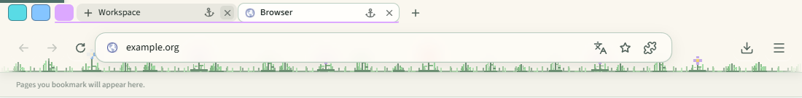

# Tab control regression fixes — 25 September 2026

The running development application reproduced the problem: mouse selection was acknowledged in 5–10 ms, while a loaded target remained pending after 1.8 seconds and repeated 1.5-second paint probes. Switching back to the outgoing tab completed immediately. Inspection also confirmed an unintended native outset border on group buttons.

## Changes

- Compile the shell's shared CSS through the dashboard's installed Tailwind/PostCSS pipeline. This restores the original reset, utility classes, control spacing, and continuous group underlines. Scan only the shell bundle's source dependencies.
- Share the existing 4 px green progress component between dashboard pages and the bundled shell. The bar is at window y=0, above the tab strip. Page loading reports are validated against the sending tab and document generation; page copies of the bar stay hidden under the persistent shell.
- Park first-frame preparation below the persistent toolbar. The old top-right parking pixel was completely covered, preventing compositor frames with normal Windows occlusion.
- Keep a reused browser background parked when arriving from a local page. A previously painted shared browser renderer is not evidence that the current website can cover it. The outgoing page remains visible until the website is ready.
- Register every saved tab before starting the two-worker restore queue. Foreground selection can start a queued tab immediately. Bound document/widget waits; continue their work in the background after the ceiling. Remove the redundant fonts/idle/FCP wait after startup content readiness. Closed tabs are not reinserted when restore finishes.

The 128 MiB surface cache, pressure response, document retention, and browser security boundaries are unchanged.

## Verification

- Desktop TypeScript build and bundled shell build passed.
- Focused dashboard TypeScript and ESLint passed.
- UI checks verify zero native group-button border, exactly aligned group/tab underlines, a 32 px strip, browser chrome ending at y=135, and the original green bar at y=0 with height 4. Close remains clickable while progress is visible.
- All seven startup integration cases passed: ordinary, signed-in, welcome, shutdown during restore, slow resources, opening/selecting during restore, and a widget that never settles.
- Native shell coverage includes default and 200% DPI, a visible window with normal Windows occlusion, forced cache eviction, rejected frame checks, streaming HTML, slow images, close while loading, repeated close, resize, stalled renderers, and document retention. Page loading IPC rejects a different sender and stale generation.
- Earlier broad regressions in this pass: 13/13 desktop cases. Final shell/control/switch rerun passed 5/5 (`tab-regressions.log`); final UI rerun passed 6/6 (`ui-regressions.log`).

## Physical input and display timing

Electron 33.4.11, Chromium 130.0.6723.191, display scale 1.25. Actual Windows mouse input and screen-pixel sampling; a second click changes the page background to prove that its controls work. Selection-state updates do not count as visible presentation.

This deliberately forces critical memory pressure and a **zero-byte additional surface cache**. All 120 measured destinations were loaded documents with evicted surfaces, alternating the final local/browser pair among 5, 15, or 30 total tabs. This measures the slower restoration path, not resident switching or network load latency.

| Total tabs | Controls p95 (ms) | Visible p50 / p95 / p99 (ms) | Working control p95 (ms) | Unexpected pixel samples |
| --- | ---: | ---: | ---: | ---: |
| 5 | 100.2 | 132.8 / 152.0 / 167.1 | 232.1 | 0 |
| 15 | 116.4 | 133.2 / 167.0 / 184.1 | 234.1 | 0 |
| 30 | 117.0 | 117.4 / 167.0 / 184.2 | 233.8 | 0 |

No sampled body pixel showed a blank/dashboard frame in the final 120 switches. This is a sampled-point check, not proof about every pixel of every frame. Physical capture/input adds observer overhead. The original 50 ms control / 100 ms resident-display targets are not claimed from this forced-eviction run. Raw samples are in `evicted.json`; the runner output is in `native-pixels.log`.

An initial forced-eviction run caught the reused-browser-background flash. The final data above was collected after correcting that ordering.

The user's running Breadboard process was not restarted. Restart the development desktop to load the new main-process tab manager and preload code; the source and desktop build are updated. No user tab, document, or saved session was deleted by the verification fixtures.
