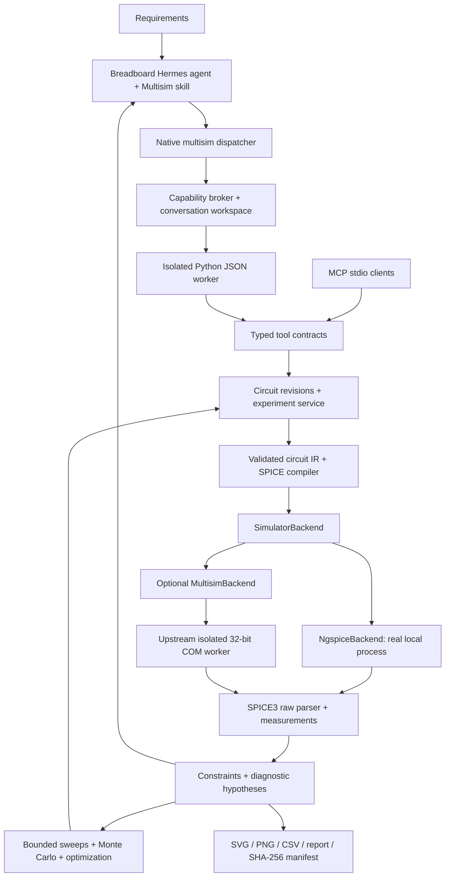

# Breadboard Multisim Agent

A native circuit engineering skill and Python tool service adapted from
[multisim-mcp](https://github.com/yxy050208/multisim-mcp). Breadboard's agent can
design and revise circuits, run real simulations, measure requirements and optimize
component values. **ngspice is the default; NI software is optional.**

This is an integration of the upstream architecture and source, with a typed
Breadboard circuit API. It does not implement a replacement circuit solver.
See the [architecture and capability mapping](docs/UPSTREAM_MAPPING.md) and
[pinned source inventory](vendor/UPSTREAM.json).

## View and reopen a circuit

Ask Super Agent to design a circuit and export its circuit project. The native
`multisim` tool's `export_circuit_project` (also `render_schematic`) returns a
`.bbcir` file, connected SVG/PNG/HTML, editable JSON and an analysis-independent
SPICE deck. The project embeds the circuit, models, netlist, placements and routed
wires; it is a Breadboard format, not an NI Multisim `.ms14` file. Simulation decks
and their control blocks remain unchanged. Ground and static supply rails use
common labels; signal nets have explicit orthogonal wires and junctions.

Import `project_path` and `view_path` using `artifact_import`. Open the project in
Breadboard's artifact pane to zoom, trace pins/nets, inspect subcircuits, reposition
symbols, export SVG and save the layout. Code/component edits are made through
the native agent tools; layout dragging does not change electrical connectivity.
`import_circuit_project` reopens the circuit as a new editable design and checks
its netlist/hash. The self-contained HTML also displays in older Breadboard builds
and embeds project data; use the separate project/netlist artifacts for downloads. Raw SPICE files retain the
netlist-viewer connectivity view; routed layouts are carried by `.bbcir` projects.

Exports are bounded to 200 components / 1200 pins. Unroutable projects fail with
an explicit explanation rather than substituting disconnected component tiles.
Simulation data survive an optional schematic export failure, with a warning in
the report. The review shows component counts, unused terminals and model limits;
an export never claims hardware verification. For labs, read the assignment,
verify the delivered control wiring and distinguish simulation from bench work.

## Export to LTspice and Multisim

The native tool now exposes `export_ltspice(circuit_id, analysis?)` and
`export_multisim(circuit_id)`. LTspice exports are editable `.asc` schematics using
the pinned [Weave](https://github.com/senolgulgonul/weave) layout engine. The ZIP
includes custom `.asy` symbols and inline models; extract the whole ZIP before
opening `circuit.asc`. Multisim exports are binary `.ms14` projects built with
multisim-mcp and the open-source
[Electronics Workbench codec](https://github.com/cinderblock/electronics-workbench-decoder).
Expandable subcircuits become editable primitive components; unsupported models
or layouts fail with an explanation.
Multisim currently requires the default 27 C and rejects instance parameters on
passive components and independent sources instead of silently dropping them.

`npm run setup:multisim` also installs the locked exporter dependencies. To add
Multisim's local component templates from your licensed installation, run
`node scripts/setup-multisim-exports.mjs --multisim-python <32-bit-python-with-pywin32>`.
Save and close Multisim first. If its automation API is unavailable,
`--multisim-sample-shell` uses installed samples and records that application
compatibility remains unverified. NI template data stays in the ignored `.runtime`
directory. `runtime_status` reports exporter availability and setup guidance.

Ask the agent to export your circuit to LTspice or Multisim. It delivers the
schematic and project ZIP through `artifact_import`. Every bundle records hashes,
the source revision, upstream versions and validation scope. File encoding and
layout checks do not imply successful simulation in the destination application.

## Installation

Requires Python 3.11+ (setup selects 3.12), uv, Node for Breadboard setup, and
ngspice on PATH. On Windows use the console binary `ngspice_con.exe` if provided.
Install the complete ngspice distribution, including its `spinit` and XSPICE
libraries; copying only the executable can run simple R/C circuits but fails on
the polynomial sources used by manufacturer op-amp models. The worker resolves
installation-local startup scripts for relocated Windows distributions and
honors an operator-provided `SPICE_SCRIPTS` path.
Get ngspice from its [official download page](https://ngspice.sourceforge.io/download.html),
your Linux distribution (`apt install ngspice`) or Homebrew (`brew install ngspice`).

From the Breadboard checkout:

```sh
npm run setup:multisim
npm run test:multisim
```

Setup creates `.runtime/multisim-venv`, installs the service, probes ngspice, writes
an operator-owned `.runtime/multisim.json` runtime descriptor and copies the skill
to Breadboard's first-party catalog. It does not download or license NI software.
If ngspice is outside PATH, set `BREADBOARD_NGSPICE` to its executable **during
setup**; the resolved path is stored in the descriptor. A checkout-local installation
at `.runtime/ngspice/Spice64/bin` is also recognized. Start a new conversation after
setup so Hermes can discover the tool without changing an existing prompt cache.
If Breadboard was running while this integration was first installed, restart it
once to reload Hermes's Python plugin registry, then start a new conversation.

Standalone installation:

```sh
python -m pip install ./multisim-service
breadboard-multisim --workspace ./circuit-workspace doctor
breadboard-multisim --workspace ./circuit-workspace serve
```

The Python package includes the pinned MIT upstream source; the inspection clone
is not required at runtime. Generated simulation output and binaries are ignored
by Git. The source integration is ready for local development; distributing this
optional Python/ngspice runtime in Breadboard's signed desktop installer is a
separate packaging task, not silently assumed by the current setup command.

## Breadboard integration

Select the **multisim-agent** skill, or ask Breadboard to design/simulate a circuit.
With **Super Agent** enabled, the skill is included in its automatic inventory on
both Terminal and Garden chat. It can open the skill and call `multisim` directly;
no manual skill selection, agent delegation or separate MCP connection is needed.
For example, enter **“Create a low-noise amplifier with 20 dB gain”** or
**“Build and simulate an RC low-pass filter with a 1 kHz cutoff.”** The circuit
work stays in the current conversation, with normal thinking activity and results
in the reply. Multisim does not launch or display a separate agent card.
The per-turn capability broker explicitly grants the tool for private conversation
workspaces and denies it on public, anonymous and isolated sessions.

Open an exported SPICE artifact (`.cir`, `.ckt`, `.sp`, `.spice`, or `.net`) in
Breadboard's artifact pane to inspect the circuit. The native SVG viewer adapts
[netlist-viewer](https://github.com/f18m/netlist-viewer): select components and
trace nets, open subcircuits, pan/zoom, drag/rotate symbols, inspect the original
source, or export the current view as SVG. Existing netlist artifacts previously
shown only as downloads also open in the viewer. No additional executable or
agent card is needed. See the [viewer integration and limits](../dashboard/src/vendor/netlist-viewer/README.md).

The service-gated native `multisim` tool takes an action and its arguments:

```json
{"action":"runtime_status"}
{"action":"read_reference","arguments":{"name":"design"}}
{"action":"describe_tool","arguments":{"name":"create_circuit"}}
```

`read_reference` provides the four engineering workflows and five editable circuit
examples directly in chat. They are included in the Python wheel, so the agent
does not need shell or arbitrary filesystem access to follow the skill's links.
When Hermes uses deferred tools, invoke its `tool_call` with
`{"name":"multisim","arguments":{"action":"runtime_status","arguments":{}}}`.
All subsequent operations use the same outer wrapper. Both invocation paths reach
the same scoped native callback and appear as ordinary circuit activity.

Hermes sends the call to `/api/hermes/tools/multisim`. Breadboard validates the
capability token, active turn grant, session and conversation ownership, then runs
the local worker in the conversation workspace under `.breadboard/multisim`.
Circuit IDs do not grant access across workspaces. The model cannot choose a host
command, interpreter or workspace path. Tool completion is audited.

All operations are individually exposed on the native MCP stdio server. A generic
MCP configuration uses:

```json
{
  "mcpServers": {
    "breadboard-multisim": {
      "command": "/absolute/path/to/python",
      "args": ["-m", "breadboard_multisim", "--workspace", "/absolute/path/to/circuits", "serve"]
    }
  }
}
```

`breadboard-multisim tools` emits complete JSON schemas. `call <tool> --input
arguments.json` reads an argument file; omitting --input reads JSON from stdin.
Results are JSON on stdout; MCP uses stdout exclusively for its protocol.

## Circuit representation and device coverage

```json
{
  "title": "Divider",
  "components": [
    {"id":"V1","type":"voltage_source","value":5,"nodes":["vin","0"],"ac":1},
    {"id":"R1","type":"resistor","value":"10k"},
    {"id":"R2","type":"resistor","value":"10k","nodes":["vout","0"]}
  ],
  "connections": [["R1.1","vin"],["R1.2","vout"]]
}
```

Supported devices: resistors, capacitors, inductors, diodes, three-terminal BJTs,
four-terminal MOSFETs, five-terminal op amps, independent voltage/current sources,
and 2–64 pin inline IC subcircuits. Sources support DC, complex AC amplitude/phase,
PULSE, SIN and PWL. Custom models carry definition and provenance; IC pin order
matches the .subckt declaration. Model files are supplied inline, not executed
through unrestricted .include/.control commands. More SPICE-specific primitives
remain available in upstream compatibility mode.

All IDs are case-insensitive electrically. Ground aliases map to 0. `M` is milli;
use `meg` for mega. Incomplete circuits may be edited, but simulation requires
all pins connected, a ground and all referenced models.

## Simulations, measurements and optimization

| Capability | Operations and semantics |
| --- | --- |
| Editing | create/load/add/remove/connect/disconnect/modify, model registration, SPICE export; atomic revision checks |
| Bias | run_operating_point; independent-source DC sweep |
| Frequency | run_ac_analysis; complex voltage/current and transfer response |
| Time | run_transient_analysis with bounded timestep and measurement windows |
| Noise | run_noise_analysis; output density V/√Hz and integrated V RMS over the declared band |
| Measurement | Voltage, current, absorbed power, gain, upper cutoff, explicit loop phase margin, settled oscillator frequency and harmonic THD |
| Verification | Minimum/maximum/target requirements return pass, fail or unverified |
| Diagnosis | Retained logs, affected measurements, topology-aware hypotheses and proposed checks |
| Sweeps | Cartesian component/parameter values, maximum 100 simulations |
| Monte Carlo | Seeded uniform or 3-sigma normal component tolerances, measured yield |
| Optimization | Bounded population/coordinate search, weighted targets, hard constraints and independent final verification |
| Visualization | Pin/net-labelled schematic, waveform, transient, Bode gain/phase and sweep plots; SVG/PNG and CSV |

Gain and phase use complex transfer data. Transient mean/RMS measurements integrate
over adaptive timesteps. Bandwidth means upper cutoff relative to the specified
passband reference; missing crossings are not extrapolated. AC real power assumes
peak phasors. Phase margin requires a correctly signed loop-gain testbench preserving
DC bias/loading; a closed-loop amplifier response is insufficient.

The built-in op amp has finite open-loop gain, one dominant pole and rail limiting,
but **no intrinsic noise, slew limit or supply/output-current model**. A real
low-noise amplifier claim requires a suitable device model. Generic transistor
fixtures likewise do not establish commercial-device or hardware qualification.

Native broker calls are bounded to 330 seconds; studies may use at most 300 seconds
inside that boundary. Direct CLI/MCP studies can request up to 3600 seconds and 100
evaluations. Individual analyses allow at most 300 seconds and 1,000,000 points,
with a 256 MiB raw-file ceiling. Errors retain evidence. Studies persist progress,
support cancellation, and leave the baseline unchanged; they do not automatically
resume after external worker termination. Apply a verified candidate explicitly
with expected_revision. Search success is not a guarantee of a global optimum.

## Examples

The [skill examples](../skills/multisim-agent/examples/) include all five regression
circuits. To run one from Python:

```python
import json
from pathlib import Path
from breadboard_multisim.service import CircuitService
from breadboard_multisim.tools import dispatch

service = CircuitService("./circuit-workspace")
circuit = json.loads(Path("skills/multisim-agent/examples/opamp-amplifier.json").read_text())
state = dispatch(service, "create_circuit", {"circuit": circuit})
result = dispatch(service, "run_circuit_experiment", {
    "circuit_id": state["circuit_id"],
    "analysis": {"kind": "ac", "start": 10, "stop": 1e8},
    "measurements": [{"name": "gain_1k", "kind": "gain", "node": "vout", "input_node": "vin", "frequency": 1000}],
    "constraints": [{"measurement": {"name": "gain_1k", "kind": "gain", "node": "vout", "input_node": "vin", "frequency": 1000}, "target": 20, "absolute_tolerance": 0.1}],
})
print(result["verification"], result["directory"])
```

Each experiment includes circuit.json, analysis.json, circuit.cir, run.txt, run.log,
result.raw, data.json, data.csv, result.json, report.md and manifest.json. Rendered
runs add schematic SVG/PNG and waveform or Bode SVG/PNG. `inspect_artifacts` checks
integrity. Revision history and study summaries remain on disk across tool calls.

## Architecture



## Optional NI Multisim and upstream compatibility

Install a licensed compatible NI Multisim environment and provision its 32-bit
Python worker according to [upstream installation guidance](https://github.com/yxy050208/multisim-mcp/tree/33ec7f42bf2885084a459a702a83ea3d87f95f9d/mcp_server).
Configure `MULTISIM_MCP_WORKER_PYTHON` and, for native .ms14 generation, a locally
bootstrapped component pack. Install optional Python dependencies with
`pip install './multisim-service[multisim]'`. The worker interpreter needs the
upstream package/dependencies too; an existing properly configured upstream worker
is usable. Do not install this numpy/matplotlib package into a 32-bit interpreter.

`breadboard-multisim --backend multisim ...` selects the COM backend for native
OP/DC/AC/transient API calls. Noise remains ngspice-only. Real COM execution has
not been tested in this environment. `breadboard-multisim upstream` launches the
unchanged 107-tool server with its original prompts, resources, durable jobs,
native component operations, approvals and HTML/PDF reports. That surface retains
the upstream environment/configuration and does not inherit the native --workspace
or --backend switches; configure its output roots using the upstream tools.

## Verification and maintenance

```sh
npm run test:multisim
node --experimental-strip-types --test dashboard/tests/multisim-service.test.mjs dashboard/tests/multisim-route.test.mjs dashboard/tests/multisim-super-agent.test.mjs
```

The first command requires ngspice and fails rather than silently skipping the
engineering regressions. COM-free tests can run via `python -m pytest
multisim-service/tests -m 'not integration'`. MCP transport tests launch real stdio
subprocesses. CI installs ngspice on Linux; local Windows verification uses ngspice 42.
See [mapping](docs/UPSTREAM_MAPPING.md) for source attribution and update procedure.
The [verification record](docs/VERIFICATION.md) lists completed checks and acceptance boundaries.

## Roadmap

- Installer provisioning for the optional Python/ngspice worker, plus a supervised
  Runtime V2 job executor for cancellation and restart recovery across app shutdown.
- Broader vendor-model acceptance fixtures, correlated process/temperature corners
  and multiple-analysis optimization constraints.
- General band-pass width and all-crossover/Nyquist stability reports.
- Rich interactive schematic editing and improved automatic wire routing.
- Licensed NI acceptance tests on supported Multisim versions; no emulated success.
